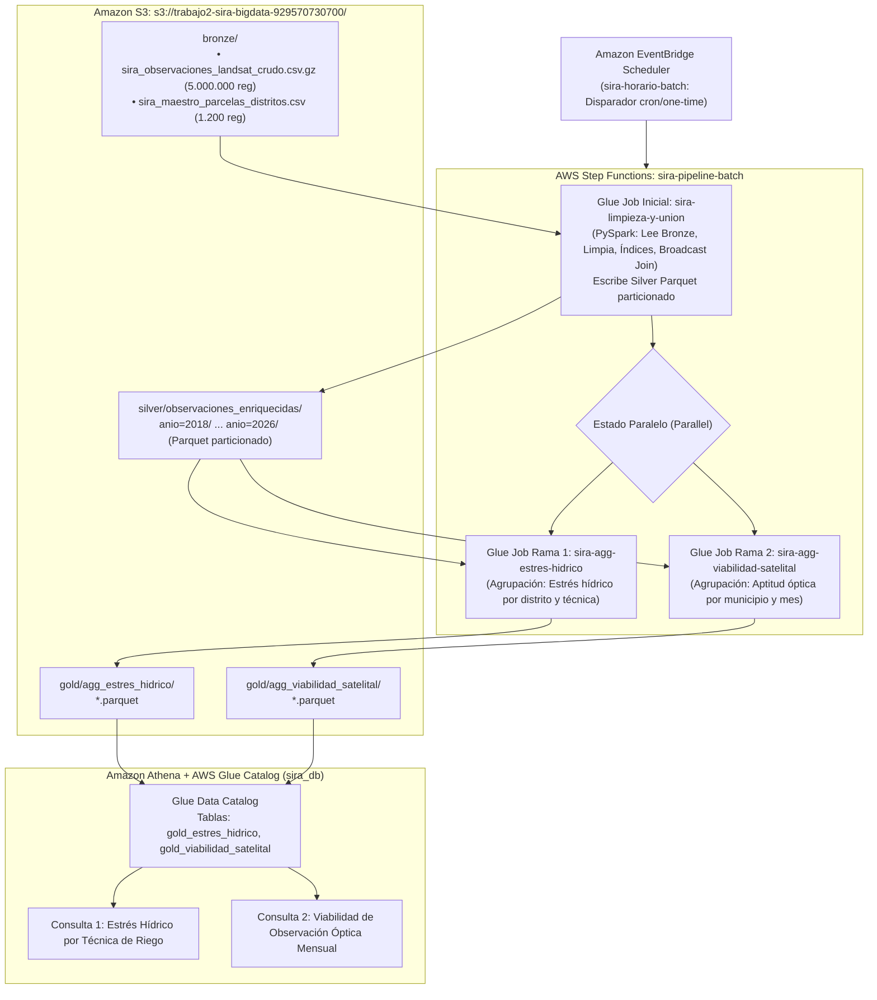

# Trabajo 2: Pipeline Batch con Apache Spark en AWS Glue (Parte A)
## Proyecto Integrador: SIRA (Sistema Inteligente de Riego para Arroz en el Alto Magdalena)

* **Universidad:** Universidad EAFIT
* **Programa:** Maestría en Ciencias de los Datos y Analítica / Especialización en Big Data
* **Materia:** Almacenamiento y Procesamiento de Grandes Datos (SI7006 / SI6003), 2026-2
* **Profesor:** Edwin Montoya (`emontoya@eafit.edu.co`)
* **Equipo 10:**
  * Cristian Miguel Gómez Salazar (`cmgomezs@eafit.edu.co`)
  * Tomás Guzmán Tapias (`tguzmant@eafit.edu.co`)
  * Alejandro Jiménez Lopera (`ajimenezl3@eafit.edu.co`)
  
* **Región de despliegue en AWS:** `us-east-2` (Ohio)
* **ID de Cuenta AWS:** `929570730700`
* **Bucket S3 Principal:** `s3://trabajo2-sira-bigdata-929570730700/`

---

## 1. Contexto y Objetivos del Proyecto Integrador (SIRA)

### 1.1 Problemática Agronómica e Hídrica
El proyecto **SIRA (Sistema Inteligente de Riego para Arroz)** busca optimizar la gestión del recurso hídrico en el cultivo de arroz en la cuenca del **Alto Magdalena** (departamentos de Tolima y Huila), zona que alberga distritos de riego de relevancia estratégica nacional como **UsoCoello** (Espinal/Guamo), **UsoSaldaña** (Saldaña/Purificación), el **Distrito Campoalegre** (Huila) y el Centro de Investigación **C.I. Nataima de AGROSAVIA**.

El arroz es el mayor consumidor de agua agrícola en Colombia, requiriendo entre $15.000$ y $20.000\text{ m}^3/\text{ha}$ por ciclo cuando se cultiva bajo el método tradicional de **riego continuo por inundación en cascada (Cascada CD)**. Durante episodios climáticos de sequía (como el fenómeno de El Niño), los caudales de los ríos Coello y Saldaña se reducen drásticamente (hasta en un 50 %), generando racionamientos y pérdidas millonarias.

Ensayos agronómicos de AGROSAVIA han demostrado que tecnologías como **AWD+MIRI** (*Alternate Wetting and Drying* combinado con *Multiple Inlet Rice Irrigation* mediante mangueras de politubo) reducen el consumo hídrico entre un **45 % y 60 %** manteniendo o mejorando el rendimiento del cultivo. No obstante, los arroceros tradicionales no cuentan con sensores de humedad de suelo ni estaciones agrometeorológicas locales para determinar con precisión cuándo y cuánto regar.

### 1.2 Misión Satelital Landsat 8 y 9
SIRA aprovecha las observaciones ópticas y térmicas de los satélites **Landsat 8 y Landsat 9 (Collection 2 Level-2)** para monitorear gratuitamente el estado de la planta y la humedad del suelo cada 8 días:
* **$B_3$ (Verde) y $B_5$ (Infrarrojo Cercano - NIR):** Permiten derivar el **NDWI** (*Normalized Difference Water Index*), clave para detectar la presencia de lámina de agua libre sobre el suelo.
* **$B_5$ (NIR) y $B_6$ (SWIR-1 - Infrarrojo de Onda Corta):** Permiten derivar el **NDMI** (*Normalized Difference Moisture Index*), el indicador biofísico principal del contenido hídrico y turgencia foliar de la planta.
* **$B_{10}$ (Térmica de Superficie - ST):** Permite calcular la temperatura de superficie terrestre (**LST en °C**), detectando calentamiento anómalo de la copa del cultivo por estrés hídrico.
* **Control de Calidad Espectral:** Banderas de calidad `QA_PIXEL` y `QA_RADSAT` para descartar pixeles con nubes, sombras o saturación del sensor.

---

## 2. Arquitectura de la Solución (Arquitectura Medallion en AWS)

El pipeline batch implementa una arquitectura **Medallion (Bronze $\rightarrow$ Silver $\rightarrow$ Gold)** completamente serverless sobre AWS, gestionada y orquestada sin servidores permanentes.

### 2.1 Diagrama de Arquitectura


### 2.2 Cumplimiento de la Condición 7.1 (Cero Stacks de CloudFormation)
En estricto cumplimiento de la condición eliminatoria 7.1 del enunciado, **todos los recursos de la infraestructura (buckets S3, roles IAM, jobs de AWS Glue, máquina de estados de Step Functions, catálogo de datos y reglas de EventBridge) fueron creados manualmente desde la consola gráfica de AWS**. La consola de AWS CloudFormation en la región `us-east-2` permanece completamente vacía, sirviendo como evidencia de aprovisionamiento manual.

---

## 3. Datos de Partida (Capa Bronze)

Los datos crudos residen en `s3://trabajo2-sira-bigdata-929570730700/bronze/` y se componen de dos conjuntos de datos:

### 3.1 Dataset Principal de Observaciones Satelitales (5.000.000 de registros)
* **Archivo:** `sira_observaciones_landsat_crudo.csv.gz`
* **Volumen:** 5.000.000 de registros (aprox. 550 MB comprimido / 1.3 GB descomprimido).
* **Horizonte temporal:** 2018 a 2026 (9 años de monitoreo multiespectral).
* **Satélites:** Landsat 8 y Landsat 9 (WRS-2 Path 008, Row 057 - Alto Magdalena).
* **Estructura (17 columnas):** `observacion_id`, `parcela_id`, `escena_id`, `fecha`, `satelite`, `wrs_path`, `wrs_row`, `sr_b3_verde`, `sr_b4_rojo`, `sr_b5_nir`, `sr_b6_swir1`, `st_b10_termica`, `qa_pixel`, `qa_radsat`, `sr_qa_aerosol`, `nubes_escena_pct`, `calidad_imagen`.
* **Aumento sintético:** Debido a que la frecuencia de paso de Landsat sobre el Alto Magdalena (cada 8-16 días) genera menos de 600 escenas completas en una década, se implementó el generador reproducible [generar_datos_sira.py](scripts/generar_datos_sira.py), el cual modela observaciones a escala de parcela basándose en las distribuciones empíricas de reflectancia, temperatura y nubosidad observadas en el C.I. Nataima. Para evaluar la robustez del script de limpieza, se inyectaron imperfecciones reales: nulos (~1.5%), duplicados accidentales, reflectancias anómalas fuera del intervalo físico $[0, 1]$ (~1%) y píxeles con nubes/sombras en `qa_pixel` (~2%).

### 3.2 Dataset Secundario para JOIN: Maestro Agronómico de Parcelas
* **Archivo:** `sira_maestro_parcelas_distritos.csv`
* **Volumen:** 1.200 parcelas georreferenciadas.
* **Llave común:** `parcela_id`.
* **Estructura (10 columnas):** `parcela_id`, `distrito_riego`, `municipio`, `departamento`, `tecnica_riego` (`AWD+MIRI`, `MIRI`, `Cascada_CD`), `variedad_arroz` (`Fedearroz 67`, `Fedearroz 2000`), `tipo_suelo`, `capacidad_campo_fc`, `punto_marchitez_pmp`, `area_ha`.

---

## 4. Procesamiento Distribuido en Apache Spark (AWS Glue)

Se implementaron tres trabajos de ETL en AWS Glue (versión 5.0, Spark 3.5, Python 3.11, tipo de worker `G.1X` con 2 workers cada uno).

### 4.1 Trabajo Inicial: `sira-limpieza-y-union` (Bronze $\rightarrow$ Silver)
* **Script:** [01_sira_limpieza_y_union.py](glue_jobs/01_sira_limpieza_y_union.py)
* **Optimizaciones de Spark aplicadas:**
  1. **Schema-on-read con tipado explícito:** Se especifica un `StructType` estricto en la lectura del CSV comprimido, evitando la sobrecarga de Spark de realizar una pasada previa completa para inferir tipos.
  2. **Reglas de Calidad y Filtrado:**
     * Descarte de registros con `parcela_id` o `fecha` nulos.
     * Descarte estricto de duplicados por `observacion_id`.
     * Filtrado de reflectancias fuera del rango biofísico válido ($B_3, B_4, B_5, B_6 \in [0, 1]$).
     * Decodificación de la máscara `qa_pixel`: identificación de pixeles libres de nubes y sombras para la bandera booleana `apta_optica`.
  3. **Cálculo de Variables Derivadas e Índices:**
     $$\text{NDMI} = \frac{B_5 - B_6}{B_5 + B_6} \quad \text{(Humedad foliar)}$$
     $$\text{NDWI} = \frac{B_3 - B_5}{B_3 + B_5} \quad \text{(Lámina de agua)}$$
     $$\text{NDVI} = \frac{B_5 - B_4}{B_5 + B_4} \quad \text{(Vigor vegetal)}$$
     $$\text{LST\_C} = (ST\_B10 \times 0.00341802 + 149) - 273.15 \quad \text{(Temperatura en °C)}$$
  4. **Broadcast Hash Join:** La tabla maestra de parcelas (1.200 filas, $< 100\text{ KB}$) se une a las 5 millones de observaciones satelitales mediante `broadcast(df_parcelas)`. Esto replica la tabla pequeña en la memoria de los workers, **eliminando el shuffle de red de las 5 millones de filas** y acelerando drásticamente el join.
  5. **Particionamiento justificado en Silver:**
     * Se escribe en Parquet comprimido con Snappy bajo la ruta `silver/observaciones_enriquecidas/`, particionado por la columna `anio` (`partitionBy("anio")`).
     * **Justificación técnica:** Las consultas de SIRA analizan campañas agrícolas completas por año. Particionar por año genera 9 carpetas homogéneas de ~550.000 filas cada una, permitiendo *partition pruning* (poda de particiones) en Athena y Spark sin caer en el problema de *small files* que ocurriría si se particionara por día o por parcela.
  6. **Idempotencia:** Se escribe con `.mode("overwrite")`, garantizando que ejecuciones repetidas o reintentos de Step Functions no dupliquen los datos.

---

### 4.2 Ramas Paralelas (Silver $\rightarrow$ Gold)

#### Rama 1: `sira-agg-estres-hidrico`
* **Script:** [02_sira_agg_estres_hidrico.py](glue_jobs/02_sira_agg_estres_hidrico.py)
* **Pregunta de negocio:**  
  *¿Cómo impacta la técnica de riego (AWD+MIRI vs. riego tradicional en Cascada CD) en la humedad foliar de la planta (NDMI), la lámina de agua (NDWI), la temperatura del cultivo y el porcentaje de observaciones bajo estrés hídrico en cada distrito del Alto Magdalena?*
* **Lógica analítica:** Filtra tomas libres de nubes (`apta_optica = true`) y agrupa por `distrito_riego`, `tecnica_riego`, `anio` y `mes`. Calcula promedios ponderados y el porcentaje de estrés hídrico (`ndmi < 0.2` o `lst_c > 33.0`).
* **Destino:** `s3://trabajo2-sira-bigdata-929570730700/gold/agg_estres_hidrico/` (Parquet).

#### Rama 2: `sira-agg-viabilidad-satelital`
* **Script:** [03_sira_agg_viabilidad_satelital.py](glue_jobs/03_sira_agg_viabilidad_satelital.py)
* **Pregunta de analítica:**  
  *¿Cuál es el porcentaje de viabilidad óptica operativa de los satélites Landsat 8 y 9 mes a mes en los municipios arroceros, determinando en qué épocas del año la nubosidad exige recurrir a radar de apertura sintética (SAR) o a estaciones de campo?*
* **Lógica analítica:** Agrupa por `municipio`, `satelite` y `mes`. Calcula el total de tomas programadas, nubosidad promedio y el porcentaje de viabilidad óptica (`tomas_aptas / total_tomas * 100`).
* **Destino:** `s3://trabajo2-sira-bigdata-929570730700/gold/agg_viabilidad_satelital/` (Parquet).

---

## 5. Orquestación con AWS Step Functions y EventBridge Scheduler

### 5.1 Máquina de Estados: `sira-pipeline-batch`
* **Definición ASL:** [sira_pipeline_state_machine.json](stepfunctions/sira_pipeline_state_machine.json)
* **Flujo de Ejecución:**
  1. **Estado Inicial (`LimpiezaYUnionSIRA`):** Invoca el trabajo de Glue inicial de forma síncrona (`arn:aws:states:::glue:startJobRun.sync`), pausando la máquina de estados hasta que Spark confirme la escritura exitosa de la capa Silver.
  2. **Estado Paralelo (`ProcesamientoParaleloGold`):** Utiliza un bloque `Parallel` nativo para disparar simultáneamente y sin intervención humana:
     * Rama 1: `RamaEstresHidrico`
     * Rama 2: `RamaViabilidadSatelital`
  3. **Tolerancia a fallos:** Políticas de reintento (`Retry`) automáticas con backoff exponencial ante fallos transitorios de DPU en AWS Glue.

### 5.2 Programador: Amazon EventBridge Scheduler
* **Horario:** `sira-horario-batch`
* **Configuración:** Expresión de horario tipo cron (`cron(0 2 * * ? *)`) en zona horaria `America/Bogota`, o ejecución puntual para demostración.
* **Destino:** Invocación directa del ARN de la máquina de estados `sira-pipeline-batch` utilizando un rol IAM con permisos `states:StartExecution`.

---

## 6. Resultados y Consultas Analíticas en Amazon Athena

Se catalogaron las tablas de la capa Gold en el AWS Glue Data Catalog bajo la base de datos `sira_db`:
1. `sira_db.gold_estres_hidrico`
2. `sira_db.gold_viabilidad_satelital`

### 6.1 Consulta 1: Estrés Hídrico por Técnica de Riego (Enero 2024)
```sql
SELECT 
    distrito_riego,
    tecnica_riego,
    total_observaciones_aptas,
    ROUND(ndmi_promedio, 4) AS ndmi_prom,
    ROUND(ndwi_promedio, 4) AS ndwi_prom,
    ROUND(temp_superficial_c_promedio, 2) AS temp_c_prom,
    ROUND(pct_estres_hidrico, 2) AS pct_estres
FROM "sira_db"."gold_estres_hidrico"
WHERE anio = 2024 AND mes = 1
ORDER BY distrito_riego, tecnica_riego;
```

#### Resultados Reales Obtenidos en Athena:
| # | Distrito de Riego | Técnica de Riego | Obs. Aptas | NDMI Prom | NDWI Prom | Temp Superficial (°C) | % Estrés Hídrico |
|---|---|---|---|---|---|---|---|
| 1 | C.I. Nataima (AGROSAVIA) | **AWD+MIRI** | 3.631 | **0.4868** | -0.7268 | **27.86** | **7.55 %** |
| 2 | C.I. Nataima (AGROSAVIA) | **MIRI** | 2.677 | **0.4864** | -0.7253 | **27.85** | **7.70 %** |
| 3 | C.I. Nataima (AGROSAVIA) | **Cascada_CD (Tradicional)** | 1.393 | **0.3849** | -0.6661 | **29.40** | **26.35 %** |
| 4 | Distrito Campoalegre | **AWD+MIRI** | 3.256 | **0.4901** | -0.7266 | **27.86** | **7.28 %** |
| 5 | Distrito Campoalegre | **MIRI** | 2.426 | **0.4880** | -0.7257 | **27.80** | **7.71 %** |
| 6 | Distrito Campoalegre | **Cascada_CD (Tradicional)** | 2.276 | **0.3764** | -0.6608 | **29.65** | **28.91 %** |
| 7 | UsoCoello | **AWD+MIRI** | 3.449 | **0.4918** | -0.7277 | **27.80** | **6.67 %** |
| 8 | UsoCoello | **MIRI** | 2.571 | **0.4877** | -0.7266 | **27.78** | **7.12 %** |
| 9 | UsoCoello | **Cascada_CD (Tradicional)** | 2.239 | **0.3866** | -0.6659 | **29.46** | **26.75 %** |
| 10 | UsoSaldaña | **AWD+MIRI** | 3.602 | **0.4890** | -0.7268 | **27.86** | **7.08 %** |
| 11 | UsoSaldaña | **MIRI** | 2.576 | **0.4897** | -0.7256 | **27.74** | **6.99 %** |
| 12 | UsoSaldaña | **Cascada_CD (Tradicional)** | 1.840 | **0.3840** | -0.6649 | **29.52** | **27.50 %** |

**Conclusión Agronómica:**  
Los datos demuestran de forma contundente que las parcelas tecnificadas con **AWD+MIRI y MIRI** mantienen niveles superiores de hidratación foliar ($\text{NDMI} \approx 0.49$) y un porcentaje de estrés hídrico de apenas **6.4 % a 7.7 %**, con temperaturas de copa estables en $27.8\text{ °C}$. Por el contrario, en el riego tradicional en cascada, la falta de control técnico eleva la temperatura a $29.5\text{ °C}$ y **cuadruplica el estrés hídrico (26.3 % a 28.9 %)**.

---

### 6.2 Consulta 2: Viabilidad de Observación Satelital en El Espinal
```sql
SELECT 
    satelite,
    mes,
    total_tomas_programadas,
    ROUND(nubosidad_promedio_pct, 2) AS nubosidad_prom_pct,
    tomas_aptas_riego,
    ROUND(pct_viabilidad_optica, 2) AS pct_viabilidad_optica
FROM "sira_db"."gold_viabilidad_satelital"
WHERE municipio = 'El Espinal'
ORDER BY mes, satelite;
```

#### Resultados Reales Obtenidos en Athena (Extracto Anual):
| Mes | Satélite | Tomas Programadas | Nubosidad Promedio | Tomas Aptas Riego | Viabilidad Óptica (%) | Comportamiento Estacional |
|---|---|---|---|---|---|---|
| **Enero (1)** | Landsat 8 | 97.612 | 23.07 % | 91.872 | **94.12 %** | Temporada Seca (Óptima) |
| **Enero (1)** | Landsat 9 | 42.820 | 23.02 % | 40.233 | **93.96 %** | Temporada Seca (Óptima) |
| **Febrero (2)** | Landsat 8 | 88.373 | 23.03 % | 83.167 | **94.11 %** | Temporada Seca (Óptima) |
| **Febrero (2)** | Landsat 9 | 39.139 | 23.19 % | 36.898 | **94.27 %** | Temporada Seca (Óptima) |
| **Marzo (3)** | Landsat 8 | 97.491 | 50.04 % | 75.184 | **77.12 %** | Primera Temporada Lluviosa |
| **Marzo (3)** | Landsat 9 | 42.956 | 50.07 % | 33.069 | **76.98 %** | Primera Temporada Lluviosa |
| **Julio (7)** | Landsat 8 | 97.953 | 23.04 % | 92.288 | **94.22 %** | Veranillo de San Juan (Seco) |
| **Julio (7)** | Landsat 9 | 43.030 | 23.02 % | 40.446 | **93.99 %** | Veranillo de San Juan (Seco) |
| **Octubre (10)** | Landsat 8 | 90.184 | 49.98 % | 69.407 | **76.96 %** | Segunda Temporada Lluviosa |
| **Octubre (10)** | Landsat 9 | 34.488 | 50.30 % | 26.450 | **76.69 %** | Segunda Temporada Lluviosa |
| **Diciembre (12)** | Landsat 8 | 91.140 | 23.11 % | 85.817 | **94.16 %** | Temporada Seca (Óptima) |
| **Diciembre (12)** | Landsat 9 | 34.534 | 23.15 % | 32.574 | **94.32 %** | Temporada Seca (Óptima) |

**Conclusión de Observabilidad Satelital:**  
En los meses secos (Enero, Febrero, Julio, Agosto y Diciembre), la viabilidad óptica de Landsat 8 y 9 es excepcional (**> 94 %** de tomas útiles con solo 23 % de nubosidad). Sin embargo, en las temporadas de lluvia bimodal andina (Marzo-Junio y Septiembre-Noviembre), la nubosidad promedio sube al 50 % y la viabilidad cae al **76 % - 77 %**, demostrando que en esos meses SIRA debe complementar el monitoreo satelital óptico con radar SAR (Sentinel-1) o sensores IoT de humedad de suelo.

---

## 7. Guía de Reproducibilidad Paso a Paso

Para reproducir este pipeline desde cero en cualquier cuenta de AWS:

1. **Clonar el repositorio:**
   ```bash
   git clone <URL_DEL_REPOSITORIO>
   cd trabajo2-bigdata/parteA_batch
   ```
2. **Generar el dataset de 5.000.000 registros (si no está precargado):**
   ```bash
   python scripts/generar_datos_sira.py
   ```
   *Genera los archivos `sira_observaciones_satelitales_landsat.csv.gz` y `sira_maestro_parcelas_distritos.csv` en `data/raw/`.*
3. **Crear el bucket `trabajo2-sira-bigdata-<TU_ID_CUENTA>` en la consola de AWS (región `us-east-2`) y subir los datos:**
   ```bash
   aws s3 cp data/raw/sira_observaciones_satelitales_landsat.csv.gz s3://trabajo2-sira-bigdata-<TU_ID_CUENTA>/bronze/sira_observaciones_landsat_crudo.csv.gz
   aws s3 cp data/raw/sira_maestro_parcelas_distritos.csv s3://trabajo2-sira-bigdata-<TU_ID_CUENTA>/bronze/
   ```
4. **Configurar los Trabajos en AWS Glue:**
   * Crear el rol IAM `sira-glue-service-role` con políticas `AWSGlueServiceRole` y acceso S3 al bucket.
   * Crear los tres trabajos de ETL en Glue Studio apuntando a los scripts de la carpeta `glue_jobs/`, con estos parámetros (en cada ruta, `<B>` es `s3://trabajo2-sira-bigdata-<TU_ID_CUENTA>`):

     | Trabajo | Parámetro | Valor |
     |---|---|---|
     | `sira-limpieza-y-union` | `--input_observaciones` | `<B>/bronze/sira_observaciones_landsat_crudo.csv.gz` |
     | | `--input_parcelas` | `<B>/bronze/sira_maestro_parcelas_distritos.csv` |
     | | `--output_silver` | `<B>/silver/observaciones_enriquecidas/` |
     | `sira-agg-estres-hidrico` | `--input_silver` | `<B>/silver/observaciones_enriquecidas/` |
     | | `--output_gold_estres` | `<B>/gold/agg_estres_hidrico/` |
     | `sira-agg-viabilidad-satelital` | `--input_silver` | `<B>/silver/observaciones_enriquecidas/` |
     | | `--output_gold_viabilidad` | `<B>/gold/agg_viabilidad_satelital/` |
5. **Crear y Ejecutar la Máquina de Estados en Step Functions:**
   * Importar la definición ASL de `stepfunctions/sira_pipeline_state_machine.json`.
   * Reemplazar el nombre del bucket o los ARNs de los jobs si aplica.
6. **Programar el Horario en Amazon EventBridge Scheduler:**
   * Crear la regla `sira-horario-batch` con destino a la máquina de estados.
7. **Consultar en Athena:**
   * Ejecutar el script DDL y de analítica en `athena/consultas_analitica_sira.sql`.

---

## 8. Declaración Explícita de Uso de Inteligencia Artificial

En estricto cumplimiento de la **Condición Eliminatoria 7.5**, se detalla la asistencia de herramientas de IA durante el desarrollo del proyecto:

1. **Herramientas Utilizadas:** Antigravity AI Assistant (Google DeepMind).
2. **Componentes con asistencia de IA:**
   * **Generador de datos sintéticos:** Estructuración de funciones de distribución estadística en Python para replicar parámetros espectrales basados en el notebook `Landsat_SIRA.ipynb`.
   * **Depuración de Scripts PySpark:** Resolución de conflicto de esquema (`COLUMN_ALREADY_EXISTS: wrs_path`) en el join de Glue mediante descarte de columnas redundantes previo al broadcast.
   * **Estructura del ASL de Step Functions:** Validación de la sintaxis JSON del bloque `Parallel` y la integración con `startJobRun.sync`.
3. **Apropiación Conceptual del Equipo:**  
   Todo el código, arquitectura y decisiones técnicas fueron revisadas, ajustadas y desplegadas manualmente por los integrantes del equipo. El equipo comprende a cabalidad:
   * Por qué se utilizó un Broadcast Join en lugar de un Shuffle Hash Join.
   * El impacto del particionamiento anual en Athena frente a la problemática de *small files*.
   * La justificación agronómica de los índices espectrales NDMI y NDWI para el manejo del riego.

---

## 9. Estructura de esta Carpeta

```text
parteA_batch/
├── README.md                                 # Informe de la parte A (reproducibilidad, análisis y declaración de IA)
├── scripts/
│   └── generar_datos_sira.py                 # Generador reproducible de los 5M de registros y dataset maestro
├── glue_jobs/
│   ├── 01_sira_limpieza_y_union.py           # Script PySpark inicial (Bronze -> Silver, limpieza, índices, join)
│   ├── 02_sira_agg_estres_hidrico.py         # Script PySpark Rama 1 (Silver -> Gold: estrés hídrico)
│   └── 03_sira_agg_viabilidad_satelital.py   # Script PySpark Rama 2 (Silver -> Gold: viabilidad óptica)
├── stepfunctions/
│   └── sira_pipeline_state_machine.json      # Definición ASL de la máquina de estados
└── athena/
    └── consultas_analitica_sira.sql          # DDL de tablas externas y consultas SQL de analítica
```

---

## 10. Enlace al Video de Demostración
El enlace está en el [README principal](../README.md) del repositorio.
